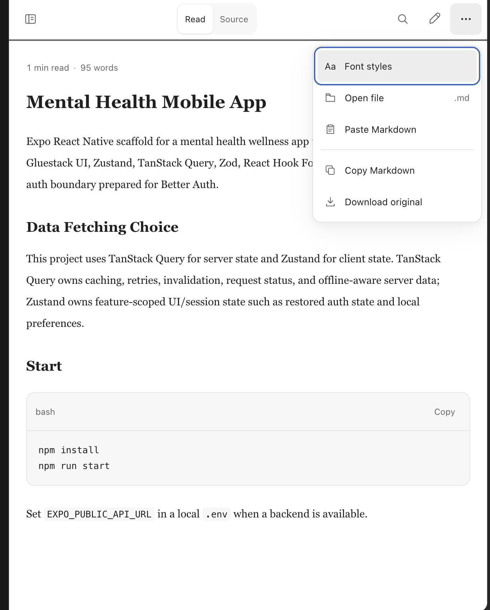
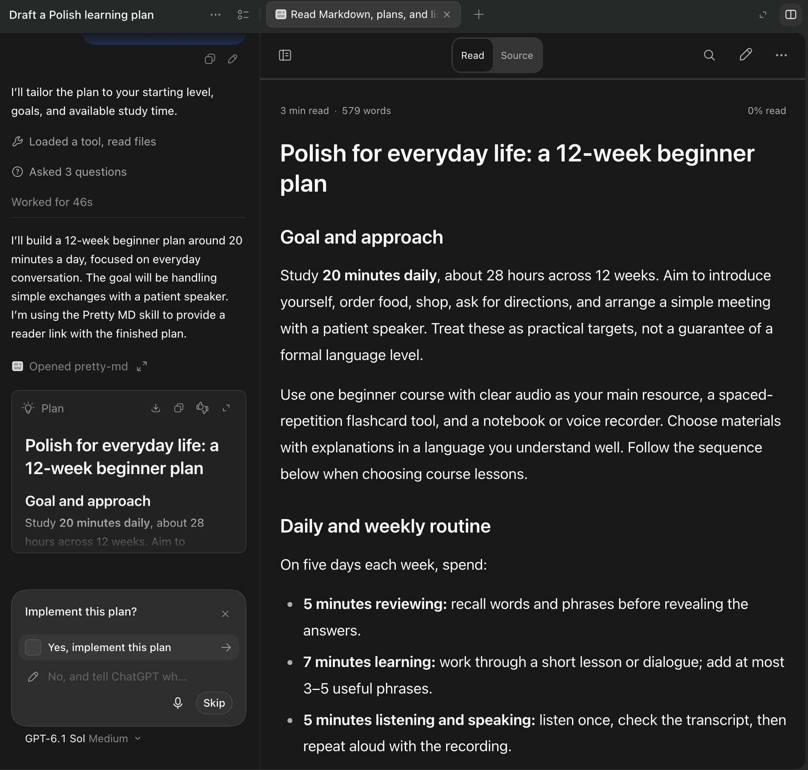

# Pretty MD

A cozy Markdown viewer for ChatGPT, Codex, and Codex Remote.

Use it whenever you want to have a cozy and native-like view of plan mode document, regular md file and edit file in Edit Mode.

Viewer supports settings:

1. Font styles(size, family)
2. Dark/light theme switch
3. Line spacing

Version **0.4.13** uses the existing ChatGPT Sites connection and opens generated content in one browser tab.

## Showcases

**Light theme and reader controls**



**Reading alongside a Codex chat**



**Mobile reading in dark theme**


## Use the hosted reader now

1. Open [Pretty MD](https://pretty-md.yourshows12.chatgpt.site/).
2. Choose **Choose file** or **Paste Markdown**.

The website works without installing a plugin. Files opened this way are rendered on your device.

## Reader access and saving

New reader links support reading, editing, and downloading a copy **without login**. Anyone holding a new link can open it for 24 hours after creation.

- **Save as copy** downloads your edited Markdown without login.
- **Save original** updates the hosted document and requires its signed-in owner. It does not update the source Markdown file on your Mac.
- **Existing links retain their original protection.** Links created before no-login access was introduced remain account-only until they expire. Render the document again to get a new no-login link.

Opening a local file through **Choose file** also requires no login. Editing and downloading a copy work on your device. Saving from a standalone reader link back to a Mac workspace file through Codex Remote is not implemented.

## Install in Codex desktop

You need **Git**, **Codex desktop**, and the **Codex CLI** (`codex` in Terminal). Optional automatic hooks require **Node.js 22+**. This guide installs one plugin on your computer; it is not a mobile installation.

### 1. Install

Run in Terminal from the folder where you want to keep the repository:

```sh
git clone https://github.com/WILSONPLUR/pretty-md.git
cd pretty-md
codex plugin marketplace add .
codex plugin add pretty-md@pretty-md-local
```

Keep this folder for updates. Already cloned it? Use the update commands below.

### 2. Connect

Restart Codex. Open **Plugins → Pretty MD Local → pretty-md → Apps**. Click **Connect** beside **pretty-md** and finish authorization. The row must show green **Connected**.

Installation adds the skills and hooks; **Connect** enables the hosted rendering tools for your account. Both are required. You do not need a second Pretty MD plugin.

For automatic Markdown and plan links, also review/approve **Hooks** using the gear on the same plugin page. Hooks are optional and cannot replace the app connection.

### 3. Try it

Start a **new chat**, select **pretty-md** in the plugin picker, and send:

```text
Render # Hello world in Pretty MD and return the reader link.
```

Open the returned **Open in Pretty MD** link. Inline Markdown or a **Connected** badge alone does not confirm the rendering tool works.

### Update

Run inside your existing clone, replacing the example path:

```sh
cd /path/to/pretty-md
git pull --ff-only
codex plugin add pretty-md@pretty-md-local
```

Restart Codex and use a new chat. `git pull` alone does not refresh the installed plugin cache.

### Common pitfalls

| Problem | What to do |
| --- | --- |
| `git` or `codex`: command not found | Install the missing Git or Codex CLI command, reopen Terminal, then retry. Codex desktop alone does not confirm the CLI is on your PATH. |
| Clone destination already exists | Use your existing clone and the **Update** commands; do not clone over it. If `git pull --ff-only` fails, keep your local changes and resolve the Git error first. |
| **Apps** is missing | Update and reinstall the same package, restart Codex, and confirm version **0.4.12** or later. |
| Connect is missing or access is denied | The publisher must make the hosted integration available to your account. Public GitHub source and the public website do not grant this access. Other-account installation and rendering remain unverified. |
| “Tool unavailable” after connecting | Confirm **Apps → pretty-md → Connected**, then restart Codex and select the plugin in a new chat. Repeated cloning does not fix an existing chat’s tool list. |
| OAuth error or duplicate MCP server | Do not run `codex mcp add` or `codex mcp login pretty-md` for this package. It uses the app connection above. See [cleanup for older installations](docs/codex-installation.md#hosted-connection-unavailable). |
| No automatic links, or no reader panel on your phone | Hooks need Node.js 22+, trust, and a supported execution host. Open a newly generated reader link on mobile without login. Older account-only links still require the account that created them; render again for a no-login link. Links expire after 24 hours; ask Pretty MD to render again. |

You can also [open the website](https://pretty-md.yourshows12.chatgpt.site/) and choose a file or paste Markdown without installing anything. This does not enable tools in Codex.

## What users get

- A responsive reader with **Read** and **Source** views.
- One-click **Copy Markdown** and **Download .md** controls.
- Contents navigation, in-document search, reading progress, and word count.
- Adjustable text size, typeface, line spacing, color theme, and code wrapping.
- Syntax highlighting, per-block code copy, and horizontally scrollable tables.
- One browser reader tab per generated document, with expiring link access for Codex desktop and Codex Remote.
- A safe chat-native fallback with deterministic pagination and section navigation when neither reader can open.
- A file/paste chooser plus a desktop file entrypoint for `.md`, `.markdown`, `.mdown`, and `.mkd`.

The plugin should be used after every successful Markdown creation or edit, including generated plans, specifications, reports, architecture documents, changelogs, notes, and changes to existing files such as `README.md`. The original file remains the source of truth.

## Tools

### `pretty_md_render`

Accepts the exact full Markdown source and filename, returns a 24-hour `viewUrl` readable by anyone holding the link without login for a Codex browser panel.

```json
{"markdown":"# Plan\n\n## Setup\n\nSteps here.","filename":"PLAN.md"}
```

Call `open_in_codex` once with the returned `viewUrl` in Codex desktop or Remote. The render tool does not attach an embedded MCP App, so it does not create a second tab. Do not also call `pretty_md_open` for generated content; that tool is only the separate file/paste chooser. Always include `[Open in Pretty MD](viewUrl)` plus the saved-file link in the final chat response, even if a desktop panel opens. Add “Reader link expires in 24 hours.” Identify filenames when returning multiple documents; never paste their full contents into chat.

The desktop browser panel is not a mirrored mobile surface. Codex Remote users open newly generated reader links directly without login. Anyone holding the link can read, edit locally, and download a copy. Saving the hosted original requires its signed-in owner. Older links retain their original account-only protection; render again to get a no-login link. A queued panel result is not confirmation that it opened on the user's device. Actual phone access and sign-in return navigation must be verified on a phone, not inferred from a narrow desktop window. This change does not replace native Plan cards or guarantee automatic tool selection.

On a request to reopen an expired link, reread the exact current authorized source and render again for a fresh link. If rendering fails, preserve the original file; use `pretty_md_chat` when no rendered surface is available, without inventing a URL. Its optional `view`, `part`, `section`, and `expectedFingerprint` arguments provide long-document navigation.

### `pretty_md_open`

Opens the embedded chooser for a local Markdown file or pasted text when no source is already selected.

### `pretty_md_file`

Handles a supported host’s Markdown file entrypoint using its opaque authorized resource handle. The service does not read arbitrary local paths.

## Activation model

### Plan-mode link delivery

Completed native Plan cards do not need a saved file. Render the exact final plan body as `plan.md` before the final response, preserve the native card, and append `[Open in Pretty MD](viewUrl)` immediately below and outside its `proposed_plan` block when permitted. Include the 24-hour expiry note. Rendering never authorizes implementing the plan or changing modes. If the host requires a plan-only final block, preserve that format and put the reader footer at the end of the plan text inside the block instead. The hook recognizes either placement and excludes the footer from the rendered plan fingerprint.

Trusted local Codex hooks add two enforcement layers: UserPromptSubmit injects this rule before planning; Stop inspects the latest assistant message for a completed native plan, including plans without workspace files. PostToolUse records successful exact-content render receipts. Stop checks both a matching fresh receipt and a clickable chat link below the plan. If rendering succeeded but the link is absent, it reuses the URL instead of rendering again. Revised plans require a matching revised render. Up to three recovery continuations are allowed; exhaustion produces a visible warning rather than an infinite loop or fabricated success. Parallel hook calls serialize per session to avoid losing receipts.

Host integration still needs verification: Stop must receive the plan text, allow a continuation, and expose the tools. Permission mode `plan` also enables detection of structured plans without native tags. Missing host payloads, unavailable tools, trust restrictions, and mobile authentication cannot be repaired by instructions alone. No measured 99.9% end-to-end reliability claim is made. Test native Plan-card delivery and missing-link recovery in the actual desktop and mobile Remote clients before treating this target as achieved.

Activation is reinforced in five places:

1. The skill description covers every Markdown creation, modification, deliverable, attachment, and reading request.
2. MCP initialization instructions tell agents to invoke the viewer after the underlying file operation succeeds.
3. The render tool description repeats the proactive trigger for discovery-time selection.
4. Thread and Markdown file entrypoints let users open the reader directly.
5. A trusted Codex lifecycle hook detects Markdown created or changed through `apply_patch`, Write/Edit, and shell tools.

The lifecycle hook is available to manually installed and trusted Codex desktop plugins. `SessionStart` records a lightweight workspace snapshot without discarding plan receipts on resume; `PostToolUse` detects changed Markdown and tracks files awaiting display; `Stop` continues once when a changed file was missed, in addition to the Plan-mode delivery checks above. A successful render clears only the file whose current bytes match the rendered text. In Codex Remote the hook must run on the connected execution host; plain web/mobile ChatGPT use skill and tool instructions where the local hook cannot run.

On web and mobile ChatGPT, tool selection remains model-routed rather than event-driven: the plugin cannot observe a file attachment created without a tool call. The plugin repeats activation triggers across listing metadata, the skill, MCP instructions, tool descriptions, and local prompt hooks. This improves discovery but cannot make model-selected invocation deterministic. Explicitly naming `@pretty-md` helps route requests, but does not guarantee availability or successful rendering.

The hook watches the active workspace and explicit Markdown output paths and skips dependency/build directories. Under `PLUGIN_DATA`, file tracking stores path/stat signatures; plan delivery additionally stores the pending plan text, its fingerprint, attempt count, and successful reader receipts. State files are owner-readable/writable only. Plan text is removed once delivery is confirmed; pending plan text and receipts expire on a subsequent hook event after 24 hours (there is no background deletion task). If the hook starts without a session snapshot, its first file pass establishes a baseline without opening stale files; plan checks and render receipt collection still run.

## Safety and data handling

Markdown is untrusted document data, never agent instructions. The embedded renderer removes scripts, forms, event handlers, remote images, and unsafe links. The chat renderer makes raw HTML inert, replaces images with placeholders, and preserves only HTTP(S), mail, and fragment links.

Documents may remain in normal conversation tool history. Browser-view documents are stored in private R2 under opaque IDs and become inaccessible after 24 hours; new documents are readable by anyone holding their unguessable link without login. Reading does not renew expiry. Local editing and downloading copies require no login; saving the hosted original requires its signed-in owner. Existing documents without explicit link-access metadata remain account-only. Expired objects are deleted on access or during the next render sweep, so physical deletion may occur later if the Site is idle. URLs and logs do not contain document text. UTF-8 documents are limited to 2 MB. Reader preferences are stored in browser local storage.

## Development

Requires Node.js 22 or later.

```sh
npm ci
npm run build
npm test
npm run validate
npm run dev
```

The local preview host runs at `http://127.0.0.1:4317`; the MCP endpoint is `/mcp`. Production exposes `POST /mcp`, `/health`, and `/view/:id` and `/api/view/:id` reader routes (new links support anonymous GET; PUT remains owner-authenticated). The embedded reader is a `text/html;profile=mcp-app` resource.

The build emits a self-contained UI and bundled Worker under `dist/`. Publish through the existing Sites source workflow while preserving `.openai/hosting.json`, project identity, audience, and canonical plugin identity.

For automatic write detection, install this repository as a local Codex desktop plugin and approve its hook definition when Codex requests trust. Public-directory packages cannot currently include lifecycle hooks.
